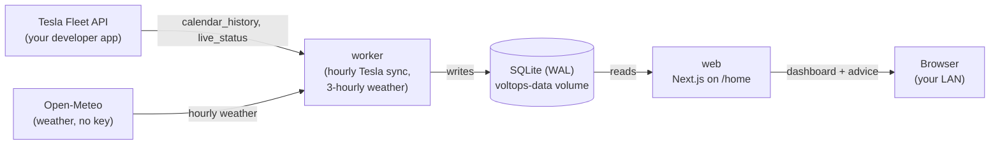

<h1 align="center">VoltOps</h1>

<p align="center">
  A self-hosted companion dashboard for Tesla Solar + Powerwall owners.<br/>
  Live energy data, weather, usage patterns, and clear advice, all on your own server.
</p>

<p align="center">
  
  
  
  
  
  
  
</p>

---

## Table of contents

- [What is VoltOps](#what-is-voltops)
- [Goals and non-goals](#goals-and-non-goals)
- [What works today](#what-works-today)
- [Architecture](#architecture)
- [Quick start (Docker)](#quick-start-docker)
- [Local development](#local-development)
- [Demo mode (no Powerwall needed)](#demo-mode-no-powerwall-needed)
- [Configuration](#configuration)
- [Connecting Tesla](#connecting-tesla)
- [Development commands](#development-commands)
- [Project layout](#project-layout)
- [Roadmap](#roadmap)
- [Privacy and security](#privacy-and-security)
- [License](#license)

## What is VoltOps

VoltOps is an **open-source, self-hosted** dashboard for Tesla Solar and Powerwall owners. You run one instance per household, on a home server, NAS, Raspberry Pi, or cheap VPS.

It:

- collects live energy data from your own Tesla system and stores the history;
- logs weather for your location;
- learns your usage and generation patterns;
- turns them into plain-language advice, with the reasoning shown. For example: *raise the backup reserve tonight, because tomorrow's peak window needs about 11 kWh.*

Your Tesla credentials and energy data stay on your instance.

## Goals and non-goals

| Goals | Non-goals (will not be built) |
|---|---|
| Observe: collect solar, battery, home load and grid flow | Multi-tenant accounts, organizations, teams, sign-up |
| Understand: usage by hour, weekday and season; cost by tariff period | Billing, subscriptions, plans, paywalls, usage metering |
| Predict: tomorrow's load and solar (planned) | Telemetry, analytics, or any phone-home to the maintainers |
| Advise: explainable recommendations with the math shown | Marketing pages inside the app |
| Act (later, opt-in): automation behind guardrails | Vehicle features. VoltOps is energy-only |

> [!IMPORTANT]
> **VoltOps is advisory only today.** It never writes to your Powerwall. Any future write (backup reserve, operation mode) will be opt-in and guarded.

## What works today

- **Home dashboard (`/home`)**: live power flow (solar, home, Powerwall, grid); today's cost by time-of-use period from your tariff; a 48-hour timeline with a forecast range; the last 7 days; tomorrow's weather; a "peak hours" estimate; and a backup-reserve recommendation.
- **Background worker**: each hour, syncs Tesla energy history and takes a live sample per Fleet API site; every 3 hours, fetches Open-Meteo weather, gap-filling past weather up to 92 days.
- **Request estimate**: in steady state this is about 1,440 Tesla requests per month per site (one `calendar_history` plus one `live_status` per hour). The `/home` footer shows the same estimate.
- **Permanent history**: energy history is kept in SQLite and not pruned.
- **Demo mode**: runs without a Powerwall, using bundled replay data.

## Architecture



The web process never polls Tesla. Only the worker does, so polling frequency is controlled in one place.

## Quick start (Docker)

Requirements: Docker with Compose, and a Tesla developer app (see [Connecting Tesla](#connecting-tesla)).

```bash
cp .env.example .env        # then fill in the values (see Configuration)
docker compose up -d --build
```

1. Open http://localhost:3000. On first run you are redirected to `/setup` to create the admin password.
2. Click **Connect Tesla** and sign in.
3. Follow the worker's progress with `docker compose logs -f worker`.

`compose.yaml` runs two services, `web` and `worker`, that share the `voltops-data` volume (`/data/voltops.db`). The worker starts after the web service is healthy.

## Local development

Requirements: Node 22 and pnpm 9 (`packageManager` is `pnpm@9.15.4`). Building `better-sqlite3` may need a C/C++ toolchain.

```bash
pnpm install
cp .env.example .env        # fill it in
pnpm dev                    # predev runs migrations first
```

Open http://localhost:3000. In a second terminal, run the worker:

```bash
pnpm worker
```

## Demo mode (no Powerwall needed)

> [!WARNING]
> The demo needs its **own database**. The `/home` page shows the first site in the database, so do not seed the demo into your real `./data/voltops.db`.

The demo still needs a filled-in `.env`. `src/env.js` validates `TESLA_CLIENT_ID`, `TESLA_CLIENT_SECRET`, `TESLA_REDIRECT_URI`, `SESSION_SECRET` and `VOLTOPS_SECRET_KEY` at startup. Placeholder Tesla values are fine. Generate the two secrets as shown in [Configuration](#configuration).

PowerShell:

```powershell
$env:DATABASE_PATH = "./data/demo.db"
pnpm db:migrate
pnpm seed:replay
pnpm dev -p 3001
```

When you are done, run `Remove-Item Env:DATABASE_PATH` (or close the terminal) to go back to your real DB.

bash:

```bash
DATABASE_PATH=./data/demo.db pnpm db:migrate \
  && DATABASE_PATH=./data/demo.db pnpm seed:replay \
  && DATABASE_PATH=./data/demo.db pnpm dev -p 3001
```

Open http://localhost:3001/home and create a throwaway admin password. To reset the demo, delete `data/demo.db`.

## Configuration

Copy `.env.example` to `.env`. Values are validated at startup (`src/env.schema.js`).

Required:

| Variable | Purpose |
|---|---|
| `TESLA_CLIENT_ID` | Client ID of your Tesla developer app |
| `TESLA_CLIENT_SECRET` | Client secret of your Tesla developer app |
| `TESLA_REDIRECT_URI` | OAuth callback. Default `http://localhost:3000/api/auth/callback`. Its port must match `VOLTOPS_PORT` |
| `SESSION_SECRET` | Session signing secret, at least 32 characters |
| `VOLTOPS_SECRET_KEY` | 64 hex characters (AES-256-GCM key that encrypts stored Tesla tokens) |

Generate the two secrets with:

```bash
node -e "console.log(require('crypto').randomBytes(32).toString('hex'))"
```

Use the output as `VOLTOPS_SECRET_KEY` (64 hex characters). The same hex command also gives a valid `SESSION_SECRET`; run it again for a second value.

Optional:

| Variable | Purpose |
|---|---|
| `DATABASE_PATH` | SQLite file. Default `./data/voltops.db` (`/data/voltops.db` in Docker) |
| `VOLTOPS_PORT` | Host port for the web UI. Default `3000` |
| `AUTH_DISABLED` | Set to `true` only for LAN-only setups. Turns off the login |
| `TESLA_FLEET_BASE_URL` | Fleet API region base URL. Default is North America |
| `SITE_LATITUDE`, `SITE_LONGITUDE` | Location for weather. Two decimal places are enough |
| `TEMPERATURE_UNIT` | `F` or `C` |
| `VOLTOPS_DEMO` | Set to `true` to seed replay data when no Tesla site exists |

<details>
<summary>Full variable list (mirrors <code>.env.example</code>)</summary>

| Variable | Required | Default | Notes |
|---|---|---|---|
| `TESLA_CLIENT_ID` | yes | none | |
| `TESLA_CLIENT_SECRET` | yes | none | Never commit |
| `TESLA_REDIRECT_URI` | yes | `http://localhost:3000/api/auth/callback` | Must be a valid URL |
| `SESSION_SECRET` | yes | none | At least 32 characters |
| `VOLTOPS_SECRET_KEY` | yes | none | 64 hex characters |
| `DATABASE_PATH` | no | `./data/voltops.db` | |
| `AUTH_DISABLED` | no | unset | Only `true` is accepted |
| `VOLTOPS_PORT` | no | `3000` | Docker host port |
| `TESLA_FLEET_BASE_URL` | no | North America endpoint | |
| `SITE_LATITUDE` | no | unset | Between -90 and 90 |
| `SITE_LONGITUDE` | no | unset | Between -180 and 180 |
| `TEMPERATURE_UNIT` | no | unset | `F` or `C` |
| `VOLTOPS_DEMO` | no | unset | Only `true` is accepted |

</details>

> [!CAUTION]
> **Keep secrets out of git.** `.env` is for your machine only. Do not commit it, paste it into issues, or put `TESLA_CLIENT_SECRET`, `SESSION_SECRET`, or `VOLTOPS_SECRET_KEY` in fixtures. If `$` appears in a value, wrap the value in single quotes, because Docker Compose interpolates `$`.

## Connecting Tesla

VoltOps uses the official **Tesla Fleet API**. You bring your own developer app:

1. Create an app at developer.tesla.com and note its client ID and secret.
2. Set `TESLA_REDIRECT_URI` to the callback URL your instance is reachable at.
3. The app requests the scopes `openid email offline_access energy_device_data`.
4. Start the app and click **Connect Tesla**.

> [!NOTE]
> Tesla bills the Fleet API per request, so polling frequency affects your bill. The worker syncs each Fleet API site once an hour. In steady state this is about 1,440 Tesla requests per month per site (one `calendar_history` plus one `live_status` per hour). The `/home` footer shows the same estimate. Check your Tesla developer dashboard for your actual usage.

## Development commands

All commands are pnpm scripts from `package.json`.

| Command | What it does |
|---|---|
| `pnpm dev` | Dev server (Turbopack). Runs migrations first (`predev`) |
| `pnpm worker` | Builds and runs the background worker |
| `pnpm build` | Production Next.js build |
| `pnpm start` | Serves a production build |
| `pnpm build:worker` | Bundles the worker to `dist/worker.mjs` |
| `pnpm db:migrate` | Applies database migrations |
| `pnpm db:generate` | Generates a new migration from the Drizzle schema |
| `pnpm db:studio` | Opens Drizzle Studio |
| `pnpm seed:replay` | Seeds the replay demo data, then exits |
| `pnpm test` | Unit tests (Vitest) |
| `pnpm test:scripts` | Tests for the helper scripts in `scripts/` |
| `pnpm typecheck` | `tsc --noEmit` |
| `pnpm lint` | ESLint via `next lint` |
| `pnpm check` | Lint plus typecheck |
| `pnpm format:check` | Prettier check |
| `pnpm verify:tesla` | Runs the read-only Tesla verification script in `scripts/` |

> [!TIP]
> `pnpm lint` (and `pnpm check`) need `SKIP_ENV_VALIDATION=1` if you have no full `.env`, because the env schema is validated at import time.

## Project layout

```
src/
  app/        Next.js App Router pages and API routes (/home, /setup, /login, /api/auth/*)
  lib/        Shared logic: advisor, weather, tariff, sources (Fleet API client), time
  server/     Server-only code: database (Drizzle), snapshot builder, replay seed
  worker/     Background worker entry point and jobs
  env.schema.js  Environment validation
fixtures/     Recorded (anonymized) API responses and replay data
drizzle/      SQL migrations
scripts/      Migration, env check, Docker smoke test, and Tesla helper scripts
docs/         Documentation and architecture notes
public/       Static assets
team/         Internal planning notes for contributors
```

The target monorepo layout (`apps/` and `packages/`) is planned but not built yet. Today everything lives in the single `src/` tree.

## Roadmap

- More dashboard screens: Plan, Trends, Accuracy, Settings, and Health
- Better forecasts (load and solar) with backtests against a naive baseline
- Local gateway data source through the MIT-licensed pypowerwall proxy (no Tesla account needed)
- Tariff editor for your own time-of-use plans
- Home Assistant / MQTT export
- Opt-in automation with guardrails (later phase, not started)

## Privacy and security

- **No telemetry.** VoltOps sends no analytics or usage data anywhere. Its only outbound calls are to Tesla (your data, your credentials) and Open-Meteo (weather, no account).
- **Single admin.** One password, stored as an argon2id hash, with a signed session cookie.
- **Encrypted tokens.** Tesla tokens are encrypted at rest with AES-256-GCM using `VOLTOPS_SECRET_KEY`.
- **Your data stays home.** Energy history lives in your SQLite file on your machine.

## License

**To be decided.** The license has not been chosen yet. Do not assume a license until one is added to this repository.
